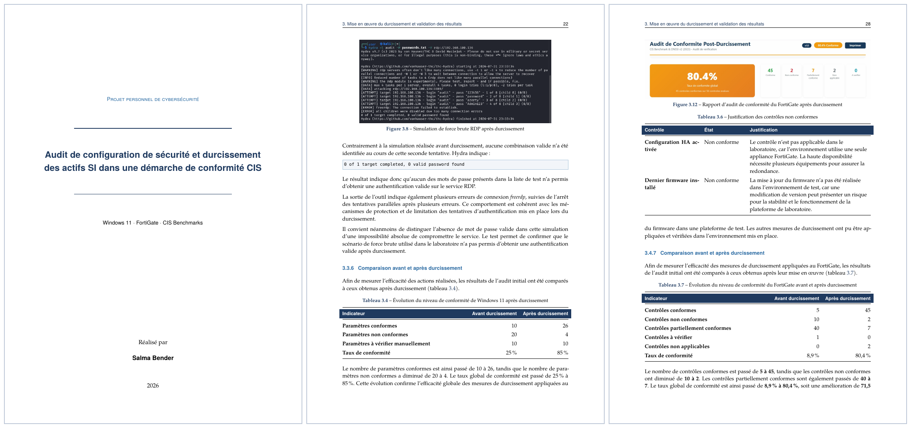

# 🛡️ Audit de configuration & durcissement de sécurité — Windows 11 et FortiGate

> Projet personnel de cybersécurité : audit de configuration et de conformité de deux actifs critiques (poste **Windows 11** et pare-feu **FortiGate**), durcissement guidé par les **CIS Benchmarks**, la **DNSSI**, les recommandations de la **DGSSI** et la **loi n°05-20**, puis validation par des audits avant/après et des simulations d'attaque en laboratoire.

📄 **Rapport complet (PDF, 37 pages)** : [`docs/audit_durcissement_CIS.pdf`](docs/audit_durcissement_CIS.pdf)



## 🎯 Problématique

Comment faire évoluer des actifs d'un niveau de maturité *Reproductible* vers *Défini*, en respectant les exigences de la loi n°05-20, de la DGSSI, de la DNSSI et des CIS Benchmarks ?

## 📈 Résultats

| Actif | Taux de conformité avant | Taux de conformité après | Détail |
|---|---|---|---|
| **Windows 11** (40 paramètres) | 25 % | **85 %** | 10 → 26 paramètres conformes, 20 → 4 non conformes |
| **FortiGate** (56 contrôles) | 8,9 % | **80,4 %** | 5 → 45 contrôles conformes, 10 → 2 non conformes |

Les non-conformités restantes sont analysées et justifiées dans le rapport (limites de l'environnement virtualisé : TPM, VBS/HVCI, appliance unique, firmware).

## 🔍 Démarche

1. **Étude des référentiels** : loi n°05-20, DGSSI, DNSSI, CIS Benchmarks.
2. **Élaboration de guides d'audit et de checklists** de conformité pour chaque actif.
3. **Audit initial** : mesure de l'état de référence (rapports HTML générés).
4. **Simulations en laboratoire** : force brute RDP avec Hydra (Windows 11), reconnaissance réseau avec Nmap (FortiGate).
5. **Durcissement** : scripts (PowerShell, configuration FortiOS) + mesures manuelles.
6. **Audit final et comparaison avant/après**, avec analyse des écarts résiduels.

## 🧰 Environnement et outils

VMware Workstation 17 Pro · Windows 11 · FortiGate-VM64 (FortiOS 7.2) · Kali Linux · Hydra · Nmap · PowerShell · LaTeX

## 🗂️ Structure du dépôt

```
.
├── docs/
│   ├── audit_durcissement_CIS.pdf   # rapport final
│   └── apercu.png                   # aperçu affiché dans le README
├── report/                          # sources LaTeX
│   ├── main.tex
│   ├── chap1.tex … chap3.tex
│   ├── conclusion.tex
│   ├── abbreviations.tex
│   └── figures/
├── LICENSE
└── README.md
```

## ⚙️ Compiler le rapport

Prérequis : une distribution TeX Live / MiKTeX avec **XeLaTeX** et les polices *TeX Gyre* et *DejaVu*.

```bash
cd report
xelatex main.tex
xelatex main.tex   # 2e passe pour la table des matières et les renvois
```

## ⚠️ Avertissement

Les tests d'attaque (force brute RDP, scans Nmap) ont été réalisés **exclusivement dans un laboratoire isolé**, sur des machines virtuelles dont je suis propriétaire. Ne reproduisez jamais ces techniques sur des systèmes sans autorisation explicite.

## 👤 Auteure

**Salma Bender** — étudiante en cybersécurité (défensif, SOC/SIEM, GRC et sécurité offensive).

## 📜 Licence

[MIT](LICENSE)
